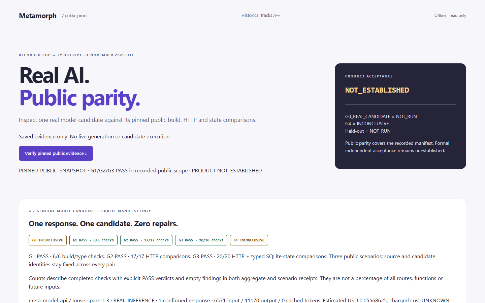
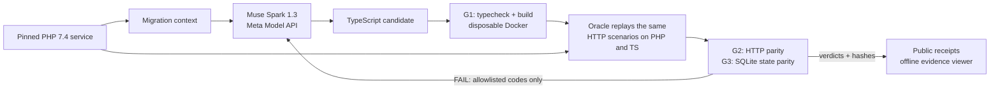

# Metamorph

**AI migrates a legacy PHP service to TypeScript. An independent Oracle checks
whether it still behaves the same, before anyone merges it.**

Built for the Meta Global AI Developer Hackathon 2026 with **Muse Spark 1.3 on
Meta Model API**. Developer tool: PHP source in, TypeScript candidate out, plus
hash-pinned evidence for every verdict.



## The problem

An LLM can rewrite a PHP service in TypeScript in minutes. Trusting the result
is the hard part. Generated code can compile, look idiomatic and still change
behavior: a JSON value comes back with a different type, a rejected booking is
stored anyway, an error path disappears. Compilers and code review rarely catch
these. Teams either read every line or ship and hope.

## What Metamorph does

1. **Generate.** Sends the pinned PHP source to **Muse Spark 1.3** (Meta Model
   API, JSON-schema structured output) with a strict migration contract and gets
   back a complete TypeScript project.
2. **Verify independently.** The Oracle is a separate package with a separate
   owner, and model confidence never counts as a pass. It builds the candidate
   in a disposable Docker sandbox. Then it runs the **original PHP 7.4 app and
   the TypeScript candidate side by side**, replays the same HTTP scenarios and
   compares every response **and the SQLite database state** step by step.
3. **Repair, within limits.** If a check fails, the model gets only allowlisted
   failure codes such as `HTTP_JSON_TYPE` for one capped repair attempt. Hidden
   test data never reaches it.
4. **Prove.** Every verdict is tied to exact SHA-256 identities of the PHP
   source, the candidate and the evaluator commit. These are published as
   public receipts that anyone can inspect offline.



## Result: a real model on a real run

On **4 November 2026**
([GitHub Actions run 41856569137](https://github.com/Meta-Project2026/Metamorph/actions/runs/41856569137)),
a single Muse Spark 1.3 response migrated an open-source PHP car-workshop
booking API (MIT). On the first attempt, with zero repairs, the candidate passed:

| Gate | What the Oracle checked (3 public scenarios) | Result |
| --- | --- | --- |
| G1 | Typecheck + build in fresh isolated pairs | **6/6 PASS** |
| G2 | HTTP responses, PHP vs TypeScript | **17/17 PASS** |
| G3 | HTTP responses + typed SQLite state, initial and after each step | **20/20 PASS** |

It used 6,571 input and 11,170 output tokens, about USD 0.056 (estimate; the
actual charge was not reported). Candidate SHA-256 `4207053a…c130e6`. Full
identities are in the [source audit](research/mmp-194/provenance.md).

Earlier real candidates from the same pipeline failed, and we keep those
failures visible. On 29 Oct one candidate did not compile. On 2 Nov one built
cleanly but returned JSON values of the wrong type. On 3 Nov a real generate,
Oracle, repair, Oracle loop still failed. Catching the "compiles but behaves
differently" case is what the Oracle is for.

## Try it in 30 seconds (no API key, Docker or install)

Requires Node.js 22.13+ or 24.

```sh
git clone https://github.com/Meta-Project2026/Metamorph.git
cd Metamorph
node research/demo-readiness/serve.mjs
```

Open <http://127.0.0.1:4171/latest.html> and click **Verify pinned public
evidence**. Your browser checks the size and SHA-256 of the saved public receipt
before showing the gates. <http://127.0.0.1:4171/> holds the full history,
including the failed runs (tracks A–F).

Full engineering checks (pnpm 11.25.0) run 1,000+ tests:
`pnpm install --frozen-lockfile && pnpm lint && pnpm typecheck && pnpm test`.

## How we use Meta's models

- **Muse Spark 1.3** via Meta Model API (`/v1/chat/completions`) generates the
  whole TypeScript candidate in one structured call. In repair mode it receives
  only Oracle failure classes and returns a revised candidate. A real
  generate, verify, repair cycle is recorded in
  [run 41726833705](https://github.com/Meta-Project2026/Metamorph/actions/runs/41726833705).
- Paid calls run only in a guarded workflow
  ([meta-paid-migration.yml](.github/workflows/meta-paid-migration.yml)). It
  requires an exact reviewed commit, explicit owner confirmation and a pre-send
  cost estimate ceiling, and allows at most 2 POSTs with no retries. The API key
  lives in a protected GitHub environment and never enters the candidate sandbox.
- Generation and verification are kept separate on purpose: the model proposes,
  the Oracle decides.

## Honest scope and what comes next

**Proven:** parity of one exact AI candidate on the recorded public scenario
manifest (3 scenarios over a small SQLite-backed booking API).

**Not yet proven, next milestones:** isolation and anti-proxy controls (G0) on
this exact candidate, which have so far run only on a separate synthetic
candidate (11 controls + 1 qualified positive). Also hidden held-out scenarios
(G4). Full product acceptance therefore stays **NOT_ESTABLISHED**, and the
viewer says so on every screen. The groundwork for both is in the repo:
`packages/g4-registry`, `packages/evidence-retention`, `packages/workshop-audit`.

## Repository map

| Path | What it is |
| --- | --- |
| [`research/demo-readiness/`](research/demo-readiness/README.md) | Offline evidence viewer (the demo), storyboard and pinned receipts |
| [`packages/agent-real/`](packages/agent-real/README.md) | Meta Model API migration adapter, bounded repair, candidate custody |
| [`packages/agent/`](packages/agent/README.md) | Agent orchestrator, budget/stop rules, Meta Model API client |
| [`packages/oracle/`](packages/oracle/README.md) | Independent HTTP + SQLite comparator, controls, PHP 7.4 reference |
| [`packages/differential/`](packages/differential/README.md) | PHP ↔ TypeScript differential bridge |
| [`packages/target-worker/`](packages/target-worker/README.md) | Disposable Docker TypeScript runtime with host admission |
| [`packages/workshop-audit/`](packages/workshop-audit/) | Independent audit harness and G0 controls |
| `packages/g4-registry/`, `packages/evidence-retention/` | Held-out registry and encrypted evidence retention (G4 groundwork) |
| `specs/`, `research/` | Specifications and dated engineering records for each milestone |

**Team:** Vladimir (migration, orchestration, integration) and Ilia
(independent baseline, comparator, Oracle). **Reused input:** the PHP
car-workshop fixture by Tanjila Afsari Rubina (MIT), with its notice kept in
[`LICENSE.upstream`](research/demo-readiness/evidence/LICENSE.upstream). Demo:
[3-minute storyboard](research/demo-readiness/SUBMISSION.md).

---

## Engineering status and developer notes

Detailed, dated status for maintainers and reviewers. Gate codes: G0 independent
complete target and controls, G1 build/type safety, G2 HTTP contracts, G3 stateful
differential parity, G4 independent held-out acceptance.

For the submission demo, run `node research/demo-readiness/serve.mjs` and open
`http://127.0.0.1:4171/`. Follow the latest-proof link to inspect recorded public
G1–G3 results for the 4 November model-generated candidate; A–F remain available
as historical evidence. Real-candidate G0 NOT_RUN, G4 INCONCLUSIVE, product
NOT_ESTABLISHED. [Three-minute storyboard](research/demo-readiness/SUBMISSION.md),
[form answers](research/demo-readiness/submission-answers.md) and
[submission checklist](research/demo-readiness/SUBMISSION-CHECKLIST.md).
The paragraphs below describe the foundation and earlier milestones.

The implemented foundation covers shared TypeScript/Zod contracts and a local
Fastify health endpoint (MMP-001), a bounded offline agent lifecycle with
scripted providers (MMP-003), a standalone
[Oracle foundation](packages/oracle/README.md) for original public/synthetic HTTP
and SQLite comparison, controls and evidence (MMP-002), the real Agent/Oracle
public repair loop (MMP-004), the disposable TypeScript target worker (MMP-007),
the PHP/TS differential bridge (MMP-008A) and the real-model workshop
composition (MMP-010A) with an independent workshop audit and encrypted
evidence retention. Real PHP 7.4 qualification executed on an isolated hosted
Docker runner (MMP-005). One authorized paid model generation executed on
2026-10-29 ([run 40900698372](https://github.com/Meta-Project2026/Metamorph/actions/runs/40900698372)):
the Muse Spark 1.3 candidate passed generation and **failed G1
build/typecheck**; G2/G3 never executed. A successful PHP→TypeScript migration,
complete product verification and formal G4 remain **NOT established**
([product milestone #61](https://github.com/Meta-Project2026/Metamorph/issues/61);
readiness preflight [#100](https://github.com/Meta-Project2026/Metamorph/issues/100)).
No benchmark is registered; the workshop profile is proposed for agreement, not
selected. The offline read-only
[evidence viewer](research/demo-readiness/README.md) presents recorded public
receipts in three separated tracks. The optional web app
is deferred until there is real run data to display. There is no automatic or
standing paid model request; billable probes require separate authorization.

The [imported architecture pack](metamorph-architecture-v0.1/README.md) remains a
proposal, including its model names, API hostname, ADR and constitution.
Coding agents start at root [AGENTS.md](AGENTS.md), then read the root
[Spec Kit constitution](.specify/memory/constitution.md) and relevant feature
documents. The root constitution is now a Metamorph working draft marked
**PROPOSED / PENDING OWNER RATIFICATION**, adapted from the imported proposal.
These are the canonical operational entrypoints; discoverability does not ratify
governance or the imported architecture. Both Vladimir and Ilia must explicitly
agree to shared cross-team API changes and governance ratification; ordinary
reversible work within authorized scope needs no repeated approval.

### Windows PowerShell

Use Node.js 22.13+ in the 22 LTS line, or Node.js 24 LTS. This task was developed
on Node 22.23.1. pnpm is pinned to 11.25.0, with exact direct dependency versions
and a committed lockfile. Install the matching package manager if necessary:

```powershell
node --version
npm install --global pnpm@11.25.0
pnpm --version
Set-Location -LiteralPath '<path to your Metamorph checkout>'
pnpm install --frozen-lockfile
pnpm lint
pnpm typecheck
pnpm test
pnpm build
pnpm start
```

In a second PowerShell window:

```powershell
Invoke-RestMethod -Uri 'http://127.0.0.1:3000/api/health' | ConvertTo-Json -Depth 3
```

Stop with Ctrl+C. To change the port, set `$env:PORT = '3001'` before startup;
remove it afterward with `Remove-Item Env:PORT`. The server binds only to
`127.0.0.1`. It reads only PORT and needs no API key, PHP, Docker or database.

Health returns HTTP 200 with `status: "ok"`, `scope: "foundation"` and explicit
capabilities: migration/Oracle `not_implemented`, Meta `not_integrated`, benchmark
`undecided`. This describes the health service, without a migration verdict. The capability
strings are that service's static labels, not current project status.

### Checks and layout

| Command | Executed work |
| --- | --- |
| `pnpm lint` | Biome lint, formatting and imports for workspace source/config/tests |
| `pnpm typecheck` | Build dependency declarations; recursively typecheck every workspace package, including a public types consumer |
| `pnpm test` | Build packages; run contracts, agent, oracle, integration, agent-real and evidence-retention synthetic/boundary tests, injection smoke and real HTTP against the built CLI |
| `pnpm build` | Compile packages in dependency order, using TypeScript |

Tests use synthetic fixtures, never a real benchmark/provider. The child server
smoke receives no credentials or PATH. Test builds exercise compiled exports.

- `packages/contracts/`: schemas and inferred types, without adapters or I/O.
- `apps/server/`: app factory, loopback CLI and health tests.
- `packages/agent/`: bounded orchestration, restricted source writer, scripted
  adapters, disabled live Meta seam and [usage/probe blockers](packages/agent/README.md).
  Run `pnpm demo:agent` for a synthetic repair/escalation lifecycle and journal;
  its PASS is synthetic orchestration evidence, never Oracle/product acceptance.
- `packages/oracle/`: independent HTTP/SQLite comparison, public synthetic controls,
  evidence and a trusted broker interface; no PHP/TS worker provisioning.
- `packages/integration/`: [real Agent / Oracle public repair loop](packages/integration/README.md).
  Run `pnpm demo:integration`: real synthetic HTTP/SQLite FAIL -> one repair ->
  G2/G3 PASS; final **INCONCLUSIVE** with actual temporary evidence packs.
  Generated text is never executed; PHP, live Meta, G0/G1 and held-out remain NOT_RUN.
- `packages/target-worker/`: [disposable TypeScript target worker](packages/target-worker/README.md)
  with trusted host admission and isolated Docker execution.
- `packages/differential/`: [Oracle-owned real PHP/TS differential bridge](packages/differential/README.md),
  without a migration model or new comparator.
- `packages/agent-real/`: [real-model workshop composition](packages/agent-real/README.md)
  with source sessions, compiler diagnostics and candidate retention; its
  execution branch stays unreachable without reviewed provider admission.
- `packages/workshop-audit/`: [independent workshop audit harness](packages/workshop-audit/)
  (public corpus recipes, ordered lifecycle, finalizer), executed by CI.
- `packages/evidence-retention/`: [encrypted local evidence adapter](packages/evidence-retention/README.md)
  for synthetic/public data only.
- `specs/005-integration/`: compact MMP-004 specification, plan and validation.
- `specs/003-oracle/`: MMP-002 spec, qualification blocker and validation records.
- `specs/004-agent/`: compact MMP-003 spec, plan, tasks and validation record.
- `specs/002-foundation/`: [spec](specs/002-foundation/spec.md),
  [plan](specs/002-foundation/plan.md), [tasks](specs/002-foundation/tasks.md),
  [interface note for Ilia](specs/002-foundation/interface-note.md).
- `specs/006-php74-qualification/` through `specs/018-mmp026-evidence-retention/`:
  PHP qualification, worker, differential, acceptance, audit, readiness and
  formal-G4 specifications for later milestones.
- `.github/workflows/ci.yml`: PR/push-to-`main` checks on a Node 22/24 matrix,
  eight-minute timeout per job: frozen install, lint, typecheck, test, build plus
  Oracle reference, target-worker, differential, PHP-qualification sanitizer,
  workshop-audit tests, active research lint/syntax, coverage-matrix validation
  with negative controls, connected history/adversarial tests and demo-readiness
  tests. Still PR-scoped: no paid, model or full-differential runs in CI.

Green Fast CI means technical checks passed. **Oracle PASS** additionally requires
independent G0–G4 execution, all mandatory scenarios and evidence for the exact
candidate. Schemas, health, unit tests and compilation do not establish parity.
See the unchanged [Oracle contract](metamorph-architecture-v0.1/docs/architecture/oracle-contract.md).

### Ilia / parallel work

MMP-001 is merged into `main` through [PR #1](https://github.com/Meta-Project2026/Metamorph/pull/1);
MMP-002/003/004/005 and the target-worker, differential, workshop-audit,
agent-real and evidence-retention packages are merged. Current open fronts,
each from current `main` in a separate checkout/branch: product milestone
[#61](https://github.com/Meta-Project2026/Metamorph/issues/61) (Vladimir) —
real model-driven migration parity NOT established; demo
[#71](https://github.com/Meta-Project2026/Metamorph/issues/71) — viewer merged,
human-timed rehearsal pending; paid-v2 readiness preflight
[#100](https://github.com/Meta-Project2026/Metamorph/issues/100) (Ilia,
offline only). Review the shared interface note together
before extending DTOs; no teammate approval is implied by local implementation.

Spec Kit 1.0.12 resolves features independently of branch names. The compact 002
documents adapt installed templates without running the broad 001 workflow or
changing `.specify/feature.json`. Explicit non-persisting feature selection:

```powershell
$env:SPECIFY_FEATURE_DIRECTORY = 'specs/002-foundation'
$env:SPECIFY_FEATURE_NO_PERSIST = '1'
& .\.specify\scripts\powershell\check-prerequisites.ps1 -Json -RequireTasks -IncludeTasks
Remove-Item Env:SPECIFY_FEATURE_DIRECTORY
Remove-Item Env:SPECIFY_FEATURE_NO_PERSIST
```

MMP-002's public/synthetic G2/G3 controls and evidence runner exist independently.
[MMP-005 real PHP 7.4 qualification](specs/006-php74-qualification/qualification-report.md)
executed on an isolated GitHub Docker runner. The sequential car-workshop profile
with a verified fixed clock has two exact clean replays; its benchmark definition
is proposed for agreement, not registered. G0/G1 for a migrated target, held-out
isolation and complete G4 remain NOT_RUN. MMP-004 connects Agent and Oracle using
trusted public synthetic fixtures only. Production isolated PHP/TS worker adapters
and verified Meta API access remain future work; model IDs and pricing require a
separately authorized live probe.

### Dependency provenance

Dependencies come from npm and retain upstream notices in installed packages.
Fastify, Zod, pnpm and Node types use MIT; TypeScript uses Apache-2.0; Biome uses
MIT OR Apache-2.0. No external project/benchmark source was copied. Retain these
notices when distributing dependency artifacts.
