# MMP-151 implementation results — 2026-11-03

**NO_GO for a live paid run: BLOCKED_BUDGET_GUARANTEE; signed repair admission
and second-candidate production custody are not implemented.**

Draft review: [PR #153](https://github.com/Meta-Project2026/Metamorph/pull/153),
refs [#151](https://github.com/Meta-Project2026/Metamorph/issues/151). No merge,
self-approval, owner ratification or independent reviewer approval is claimed.

Base was current remote main `f68b75ec0005cb76059f41218452ff57f47d50d6` when
the fresh `codex/mmp151-autonomous-repair` branch was created in an isolated clone.
Main subsequently advanced to `9021c603fba4efb1b28421cc592adb35bfebfbf1` with
unrelated demo documentation/screenshots; no overlap with this patch.
Initial implementation: `30f44cb1bb31d15fcfb784a8f8f6cba8b4aa69de`.
Smoke entrypoint fix: `c493b7e16f02c390c61a4ebb5f21181d2b8f797f`.
Current tested smoke code: `6c3f3ae77c2e5a43d553c176035e606790b6516a`.
Later documentation/evidence commits do not retroactively change a receipt's SHA.

## Delivered scope and remaining decision

This is the prompt's minimal reversible offline fallback, **not a completed
production autonomous-repair implementation**. A new workflow choice fails before
Meta/GitHub metadata/OIDC network access with `BLOCKED_BUDGET_GUARANTEE`; the
existing default single-generation admission, provider, custody and Oracle remain.
No caller boolean, CLI flag, env cap, copied admission or selected USD 1 estimate
can enable the new production mode.

The offline controller uses production request serialization, response validation,
CandidateWriter, source admission and public gate validation. Its injected ports
are explicitly SYNTHETIC and cannot mint paid or production custody capabilities.
The actual paid provider still has `maxRequests=1`, `maxRepairs=0` and unknown
guaranteed cost. No `runAgent` budget was weakened.

The existing signed authorization binds one generation body. Existing age custody
binds `GENERATION_CUSTODY`, attempt 1, the fixed generation prompt and one artifact
name/spool. A separately reviewed versioned step identity, second signed capability
and distinct artifact/readback namespace remain necessary. We did not repurpose a
generation permit or label an unsigned second artifact as production custody.
The tariff still expires **2026-11-05T00:00:00Z**; this patch does not renew it.

## State machine actually exercised offline

```mermaid
stateDiagram-v2
  [*] --> ReserveBoth
  ReserveBoth --> ClaimRun: exclusive durable directory
  ClaimRun --> Generate: fsync nonce + source/prompt/body hashes
  Generate --> Candidate1: restricted writer and SHA
  Candidate1 --> Custody1: encrypt, independent readback, acknowledgment
  Custody1 --> Oracle1: separate credential-free verifier
  Oracle1 --> Cleanup: complete PASS
  Oracle1 --> Repair: complete FAIL + allowlisted public codes
  Repair --> Candidate2: own previous full changes; no retry
  Candidate2 --> Custody2
  Custody2 --> Oracle2
  Oracle2 --> Cleanup
  Cleanup --> Outcome: zero resources required
```

Every error stops; an existing run claim rejects all process restarts and races,
even if its files are partial. There is no resumable paid protocol hidden here.
Every candidate gets a new directory; original source is not overwritten.
Complete public verification requires exact 6 G1 / 17 HTTP / 20 SQLite IDs,
3 scenario receipts, 27 public control IDs, separate evidence identities and normal
cleanup. G1 failure conservatively stops without repair. Raw messages, diagnostics,
paths, HTTP/SQL values, G0 and G4 never become repair feedback.

## Budget and privacy invariants

Two reservations are committed before the first synthetic send: exact generation
wire bytes plus a 96 KiB maximum serialized repair envelope, each using the frozen
tariff, framing allowance and 16,384 output-token ceiling. Integer nano-USD sum:
**226,332,000 + 602,112,000 = 828,444,000**, or **USD 0.828444 projected**.
The actual repair is serialized and checked against its pre-reserved envelope.
Oversize/unknown/exhausted budgets stop; estimates never refund either reservation.
This projection is explicitly **not an enforceable monetary cap**.

Synthetic mock usage estimates remain separate from `chargedCostUsd=null` and
reserved/pending projections. Actual paid requests during this work: **0**.
Each receipt says SYNTHETIC and distinguishes NEW_MODEL_GENERATION from
NEW_MODEL_REPAIR. Historical paid original and manually edited derivative are
neither read nor relabeled, and neither is used as a template.

Candidate/private evidence lives outside the repo. The local Linux smoke uses
ephemeral TEST-key pinned age encryption and separate-process decryption/readback;
it is not GitHub upload acknowledgment or the owner's production key chain.
Only sanitized metadata is eligible for Git. Raw candidate/HTTP/SQLite evidence,
test private identities and ciphertext are discarded with the disposable private
volume; summaries retain hashes/coverage/status, not restorable private packs.
The existing public source fixture is reused with its notices intact and an
original generic boolean-to-string HTTP mutant; this is not model inference or
the MMP-146 manual repair. Candidate TS/PHP execute only in restricted Docker
workers, never on the host or trusted orchestration container.

## Commands actually executed

Windows Node 24.21.0 / pnpm 11.25.0. Linux harness Node 24.22.2, Docker 29.9.2.

| Command / control | Exit | Result |
| --- | ---: | --- |
| `git fetch origin main`, fresh clone/branch, commits and pushes | 0 | New branch only; original shared checkout not edited |
| `pnpm install --frozen-lockfile` | 0 | Pinned dependencies; initial sandbox attempt hit EPERM and was rerun outside sandbox |
| `pnpm lint` | 0 | 342 files, including new package code/tests |
| `pnpm typecheck` | 0 | Existing full workspace command |
| `pnpm test` (outside Windows filesystem sandbox) | 0 | 800 tests: 690 passed, 110 platform skips, 0 failures |
| `pnpm build` | 0 | Existing full workspace command |
| `node --test packages/agent-real/test/autonomous-repair.test.mjs` | 0 | 17/17, Windows and disposable Linux; 0 skips |
| Initial development run of those tests | 1 | 12/17 passed; 5 failures exposed missing evidence references in receipt projection; fixed without changing verifier/contracts/tests to hide failure |
| Focused new + paid + migration + wire + custody + composition tests inside Windows sandbox | 1 | 158 passed, 6 skipped, 2 existing hardlink tests failed with sandbox EPERM; full unsandboxed suite subsequently passed |
| `node research/mmp-069/check-syntax.mjs` | 0 | 112 modules checked without execution |
| `node --test research/mmp-069/validate.test.mjs` | 0 | 45/45 existing inventory negative controls |
| `node --check research/mmp-151/docker-smoke.mjs` and `oracle-child.mjs` | 0 | Syntax only |
| `docker build -t mmp151-offline-harness research/mmp-108/harness` | 0 | Existing pinned trusted orchestration recipe |
| `git diff --check` / unchanged Oracle, contracts, worker, Fast CI workflow, `.specify` comparison | 0 | No shared-owner API/schema or verifier changes |

New controls include genuine child-process crash after simulated send, duplicate
claims/concurrency, no third send, first success, second failure, missing feedback,
incomplete/stale coverage, G1 fail, unknown usage, budget exhaustion/expiry,
oversize repair, HTTP/transport ambiguity, cancellation/late response, SHA mutation,
corrupted ciphertext, failed acknowledgment, final cleanup and public/ledger privacy.
Unit synthetic success uses 2 sends/1 repair/2 complete mock verifications; first
success uses 1/0/1. Ambiguity retains the run claim and both projections. None is a
real-model success claim.

Hosted Fast CI on `c493b7e` passed install/lint/typecheck/root tests/build on
Node 22/24. Node 24 root suite: 797 passed, 3 expected platform/privilege skips.
The overall run failed at the existing research inventory check because this new
manual directory had not been registered. Commit `772be02` added its inventory
entry without changing CI commands or enabling Docker in CI. Latest hosted status
on `6c3f3ae` is **PASS** for both Node 22/24:
[Fast CI run 41562089447](https://github.com/Meta-Project2026/Metamorph/actions/runs/41562089447).
The code tests and overall CI result are separate facts from Docker acceptance.

## Actual local Docker outcome: ERROR, positive acceptance not established

All three invocations used
`research/mmp-151/Invoke-DockerSmoke.ps1 -ScratchRoot <outside-repository-temp>`.
No paid provider transport was available to any of them.

| Exact source commit | Exit | Simulated sends / complete Oracle verifications | Observed result |
| --- | ---: | --- | --- |
| `30f44cb1bb31d15fcfb784a8f8f6cba8b4aa69de` | 1 | 0 / 0 | Launcher selected the previous harness entrypoint; admission rejected before smoke execution. Corrected in `c493b7e`. |
| `c493b7e16f02c390c61a4ebb5f21181d2b8f797f` | 1 | 1 / 0 | Real public Oracle detected HTTP_JSON_TYPE; only 6/17 HTTP and 7/20 SQLite executed before ENVIRONMENT_ERROR/BUILD_FAILED. No repair dispatched. |
| `6c3f3ae77c2e5a43d553c176035e606790b6516a` | 1 | 1 / 0 | Real worker typecheck phase attempted, G1/G2/G3 ERROR with ENVIRONMENT_ERROR/BUILD_FAILED; 0/17 HTTP, 0/20 SQLite. Sanitized compiler diagnostics unavailable. No repair dispatched. |

Both actual controller runs completed pinned age encryption and separate TEST-key
decrypt/readback before their Oracle invocation. Both retained the complete USD
0.828444 simulated reservation, reported `VERIFICATION_INCOMPLETE`, kept estimated
mock usage USD 0.001675 separate from unknown charged cost, and ended with
`VERIFIED_ZERO_RESOURCES` (0 containers, 0 volumes, 0 emergency removals).
The outer trusted harness and its three uniquely labeled volumes were removed.
Final Docker container inventory was empty. Candidate source hash was
`23b640dabce42a41c3d1b2496d8f6619a55c6af240e7c60a6b63a266f48f5cb5` in both
runs; they are separate run identities, not repeated requests in a single trial.

The repeated environment/build failure is **ERROR**, not proof that the candidate
failed TypeScript semantics, not a complete public FAIL, and not a repair success.
Root cause is not established by the sanitized metadata. The frozen worker's
limits and Oracle checks were not changed. Full Docker FAIL -> repair -> PASS,
17/17 + 20/20 on the repaired candidate, and a real model repair remain
**NOT_ESTABLISHED**. The complete two-attempt positive trace is proven only by the
explicitly synthetic mock-verifier tests. This acceptance gap remains in the PR;
the draft is not represented as ready for a paid run.

## Changed files and reviewer focus

- `packages/agent-real/src/autonomous-repair.mjs`: synthetic controller,
  reservation, durable claim and public feedback/coverage checks.
- `packages/agent-real/src/autonomous-repair-policy.mjs`,
  `github-meta-guard.mjs`, `meta-paid-authorization.mjs`: closed opt-in admission
  and sanitized refusal codes; no new paid capability.
- `.github/workflows/meta-paid-migration.yml`, `research/mmp-078/guard.mjs`:
  mode choice/default and explicit blocked result.
- `packages/agent-real/test/autonomous-repair*.mjs`: original synthetic fixtures,
  mock wire trace, filesystem/concurrency/privacy/negative controls.
- `research/mmp-151/`: pre-implementation design, manual isolated smoke,
  credential-free Oracle child, refusal CLI and this report.
- `research/mmp-069/coverage-matrix.json`: register manual harness in the existing
  syntax inventory; no CI expansion.

Independent reviewer should focus on the synthetic/production boundary, immutable
claims and cost semantics, complete current-candidate coverage, safe feedback,
separate source/custody identities and always-on cleanup. No independent review
has been performed by this executor. No `DECISION_GATE_ILIA` code change was needed
because Oracle/contracts/worker APIs remain unchanged. G0/G4 are INCONCLUSIVE and
product is NOT_ESTABLISHED throughout.
