# MMP-151 trust-boundary plan

Base: `f68b75ec0005cb76059f41218452ff57f47d50d6`, remote main checked
2026-11-03. Scope: implementation and SYNTHETIC controls; zero paid calls,
workflow dispatches (including validate_only), private uploads or hidden G4.

## Required production sequence

```mermaid
stateDiagram-v2
  [*] --> SignedAdmission
  SignedAdmission --> ReserveBoth: exact main + owner + review + enforceable cap
  ReserveBoth --> Generation: durable exclusive run and one-use body capability
  Generation --> Custody1: restricted writer + original candidate SHA
  Custody1 --> Oracle1: age capture + independent cleanup + artifact readback
  Oracle1 --> Done: full public PASS + normal cleanup
  Oracle1 --> Feedback: genuine public FAIL + fixed finding codes
  Feedback --> Repair: signed second capability + own previous changes
  Repair --> Custody2: new directory / SHA / encrypted artifact
  Custody2 --> Oracle2: independent verified readback
  Oracle2 --> Done: fresh workers, DBs, evidence and independent cleanup
  Done --> [*]: sanitized outcome; G0/G4 INCONCLUSIVE
```

Every incomplete/ambiguous transition terminates without retry. No restart resumes
an already claimed run. A send reservation survives timeout, cancellation, crash,
HTTP error and unknown usage. No provider estimate refunds reserved liability.

## Concrete blocking decisions

1. `PAID_POLICY` is a tariff projection, not a provider financial guarantee.
   No verified hard cap exists in the inspected code. The production opt-in must
   return `BLOCKED_BUDGET_GUARANTEE` before credential/network access, irrespective
   of YAML, CLI, environment, supplied authorization or dollar selections.
2. Existing signed admission binds only the generation request. Custody validates
   `GENERATION_CUSTODY`, `generationAttempt=1`, the fixed generation body hash,
   and one `mmp107-candidate-${runId}-1` artifact. Its spool is single-use too.
   A second paid request cannot reuse those capabilities/receipts truthfully.
   A reviewed versioned step identity and separate artifact namespaces are needed;
   this patch does not relax those checks or invent production repair admission.
3. Implement the smallest reversible slice: blocked production opt-in plus an
   explicitly synthetic two-attempt controller, using production serialization,
   response decoding, restricted writer, SHA admission and public gate rules.
   Test-only custody/verifier ports never mint production permits. A separate
   local Linux smoke invokes the unchanged real Docker verifier when available.

## Offline implementation and acceptance

- Before sending, reserve both requests monotonically in integer nano-USD:
  exact serialized generation bytes and a bounded repair wire-body envelope,
  each with the existing output ceiling/framing/tariff. Serialize the actual repair
  with only the first response's complete changes and allowlisted codes, then
  check that it fits the already reserved envelope. Sum must be <= USD 1.
- Exclusive durable run claim; unique per-step nonce, source/context/body/prompt
  hashes; fsync before simulated transport. Existing run refuses all restarts,
  including partial/truncated records. The private ledger is never a GH artifact.
- New candidate session for each response. Verify its hash before and after
  custody/Oracle. Never execute/import candidate source on the host.
- Only current-candidate, complete public receipts with normal zero-resource
  cleanup may progress. G1 FAIL stops conservatively; incomplete coverage, unknown
  cost, missing feedback, late response or failed acknowledgment stops.
- Tests: two sends/one repair/no third; first success; errors/unknown usage;
  restart/concurrency/crash; reservation bounds; privacy; wrong SHA; custody
  failures; stale/missing coverage and cleanup. Synthetic receipts stay labeled.
- Run frozen install, root lint/typecheck/test/build and focused tests. Attempt
  credential-free local Docker smoke, record environmental blockers honestly.

No Oracle/contract/schema edits, governance ratification or CI expansion. If these
become necessary: `DECISION_GATE_ILIA`, no merge. Independent security review,
deliberate merge to protected main, fresh tariff (expires 2026-11-05T00:00:00Z),
exact owner-approved request/cap decision and new signed custody architecture
remain prerequisites for production. Historical paid failure and manual derivative
are neither inputs nor outcomes of this controller.
